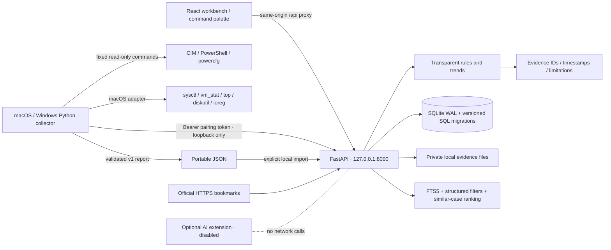
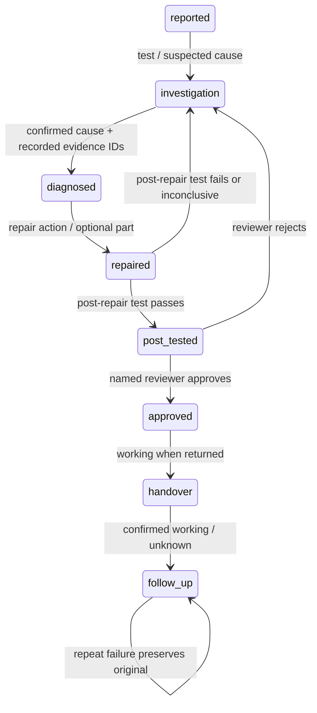

# Architecture and data ownership

## Monorepo

| Location | Responsibility |
|---|---|
| `apps/web` | React + TypeScript + Vite, Tailwind 4, custom workbench UI, Recharts + accessible data tables |
| `apps/api/main.py` | Validated API, origin/loopback boundary, scan orchestration, repair workflow, ingestion/export |
| `apps/api/db.py` | Connection/transaction boundary, repository helpers, FTS indexing |
| `apps/api/migrations` | Ordered, tracked SQL migrations |
| `apps/api/rules.py` | Deterministic current observations and trend warnings |
| `apps/api/demo.py` | Explicitly fictional seeded cases and simulated scans |
| `apps/agent/collector.py` | Windows collection and paired watcher; no arbitrary-command interface |
| `apps/agent/macos.py` | macOS read-only providers selected automatically by the shared collector CLI |
| `packages/schemas` | Authoritative typed report contract and generated JSON Schemas |
| `data/local` | Ignored SQLite file, pairing token, private evidence directory |
| `tests` | Isolated backend/collector tests and real-browser workflow |

## Storage model

Devices, scan sessions, timestamped measurements, current warnings, cases, case events, attachments, advisories, settings, and audit events have dedicated tables. Measurements carry explicit units and availability. Source provenance is embedded in each measurement, advisory, and case/event rather than being deduplicated into a shared provenance table.

Tests, numeric bench measurements, suspected/confirmed diagnoses, repair actions/parts, reviews, handovers and follow-ups are typed, append-only `case_events`. Their structured `data` fields sit alongside free-text notes. A case's current state is a projection updated in the same transaction as the new event. Repeat attempts have independent case IDs and a `parent_id`; the original outcome and event history remain intact. Uploaded bytes are outside the web root and are only downloaded with attachment disposition. They are never rendered as executable HTML.

Reports retain the original validated payload for export. Measurement row IDs identify warning evidence. Imports regenerate measurement IDs and warning references; repair event references are remapped. A duplicate report/case ID is skipped on workspace import. Agent ingestion is idempotent for identical content and rejects conflicting report IDs. Imports are transactional and force scheduled monitoring off.

`schema_migrations` records applied versions. To extend the database, add an ordered `NNN_description.sql`. Never edit a deployed migration. SQLite uses foreign keys, parameterized statements, WAL and short transactions. PostgreSQL migration would replace the connection implementation, `?` placeholders, SQLite FTS5 and a small number of SQLite-specific insert statements with a PostgreSQL adapter/search implementation. API/report types and event workflow are storage-independent. This is a pragmatic repository boundary, not an assertion that changing a connection string alone enables PostgreSQL.

## Scan lifecycle

1. User chooses categories. Backend enforces saved permissions.
2. Demo jobs generate clearly simulated results category by category. Real jobs require a connected paired watcher.
3. Watcher polls for a device-specific job. No command text is accepted from the API.
4. Before and after each bounded category, watcher reports completed categories and checks cancellation.
5. Completed/failed/cancelled reports are validated and persisted. Unsupported categories contain explicit null results with a reason.
6. Cancellation preserves completed categories. An in-flight OS command may take up to its timeout to return. Network interruption produces a partial failed report where possible; the JSON output remains available for import.
7. API restarts mark unfinished jobs failed rather than pretending they completed. Completed history survives restarts.

Monitoring is manual by default. Opt-in daily monitoring is scheduled only while the paired watcher polls. No Windows service, scheduled task, auto-start entry, or driver is installed.

## Repair state machine

Repeat failure from handover/follow-up creates a linked investigation. Re-diagnosis after a repair requires new test evidence. A handover is distinct from successful follow-up. Public aggregate source records are searchable but cannot follow a technician-confirmation workflow; unknown manufacturer/model are retained as null.

## Trust boundaries

- API and Vite bind `127.0.0.1`. API validates loopback client and Host plus configured browser Origin; cross-site fetches are rejected. Vite only allows the configured local origin.
- Collector ingestion/poll/progress require a random pairing token. UI never receives it; exports omit it. The app assumes a trusted local OS user, not adversarial multi-user tenancy.
- Collector uses literal allowlisted PowerShell scripts, fixed System32 executables, `shell=False`, and 30–45 second timeouts. No elevated subprocess launch.
- Requests and attachments are size limited. Attachments have random storage names and download-only responses.
- No raw system-event messages, hardware serial numbers, machine names, user directories, or personal document contents are collected. Native battery-report XML is temporary; only selected numeric fields leave the collector.
- User-entered notes/attachments are not automatically scrubbed: users may intentionally place sensitive repair evidence in them. JSON export excludes attachment bytes and explains that notes must be reviewed before sharing.
- No live manufacturer fetching, AI requests, or automatic driver/firmware installation exists in the core.
